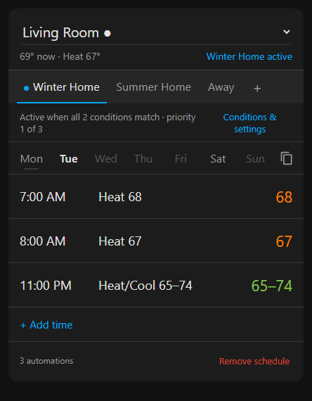
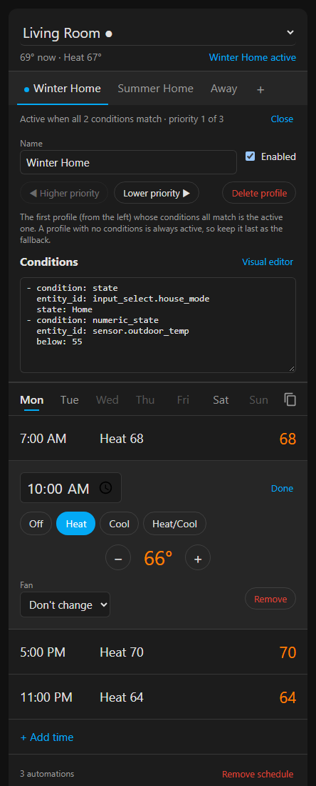

# Comfort Schedule

Control4-style thermostat schedules for Home Assistant, which run as **real automations**.

- **Profiles** sit at the top of the card. Each one has conditions you choose, such as *house mode is Home*, *outside is below 50°*, *today is a holiday* or *it's winter*.
- **Time boxes** sit at the bottom: *7:00 AM Heat 68, 10:00 AM Heat 65, 11:00 PM Cool 73*, set separately for each day.
- **Saving** writes one automation per thermostat and profile. You can see them in **Settings → Automations**, check their traces and turn them on or off there.

<p>
  
  
</p>

## Install

### HACS (custom repository)

1. HACS → ⋮ → **Custom repositories**.
2. Add this repository's URL, category **Integration**.
3. Install **Comfort Schedule** and restart Home Assistant.
4. **Settings → Devices & services → Add integration → Comfort Schedule**.

The card is included in the integration and loads by itself, so you don't need to add a dashboard resource.

### Manual

Copy `custom_components/comfort_schedule` to `/config/custom_components/comfort_schedule`, restart, then add the integration as in step 4.

### Requirement

Your `configuration.yaml` must load `automations.yaml`, which it does by default:

```yaml
automation: !include automations.yaml
```

## Use

Add the card to a dashboard:

```yaml
type: custom:comfort-schedule-card
```

With no options, the card shows a dropdown of all your thermostats. You can change that in the visual editor:

| Option | Description |
| --- | --- |
| `entity` | One thermostat. Hides the dropdown, which is useful for a per-room view. |
| `entities` | Only these thermostats appear in the dropdown. |
| `title` | Text above the dropdown. |

### Profiles and priority

- Profiles are checked from left to right, and **the first one whose conditions all match is active**.
- A profile with no conditions always matches, so keep one as the last tab to act as the fallback.
- Click a profile tab twice (or use **Conditions & settings**) to rename it, disable it, move it left or right, or edit its conditions.
- Conditions use Home Assistant's own automation condition editor: state, numeric state, time, sun, zone, template, device, and **and / or / not**.

Each scheduled thermostat gets a sensor, `sensor.<thermostat>_comfort_profile`, that shows the active profile. You can use it in your own automations and dashboards.

### Time boxes

- Pick a day, then **+ Add time**. Click a box to change its time, mode, setpoint (or low/high for Heat/Cool) and optionally the fan.
- A box stays in effect until the next box, including past midnight. A day with no boxes keeps the last box of the previous day.
- Use the copy button next to the days to copy one day to others: workdays, weekend or every day.

## How the automations work

Each automation, for example `Comfort Schedule · Living Room · Winter Home`, has:

- **Triggers**
  - every box time
  - the profile sensor changing to this profile. When the house switches from Away to Home at 9:30, the Home schedule's 7:00 box is applied right away instead of waiting for the next box.
- **Conditions**
  - the profile sensor shows this profile
  - your profile conditions
- **Actions:** work out the box in effect now, then set the HVAC mode, the setpoint(s) and optionally the fan mode.

The automations are generated: **edit the schedule in the card, not in the automation editor**. Saving the card replaces the thermostat's automations, so manual edits to them are lost. **Remove schedule** in the card deletes the thermostat's automations and its sensor.

A Home Assistant restart doesn't count as a profile change. The thermostat keeps its current setpoint until the next box time or the next real profile change.

## Development

```bash
npm install
npm test          # schedule logic
npm run build     # writes custom_components/comfort_schedule/frontend/comfort-schedule-card.js
pip install pytest-homeassistant-custom-component pyyaml
pytest            # automation builder + end-to-end tests in Home Assistant
```

The built card is committed because HACS installs the integration folder as it is.
